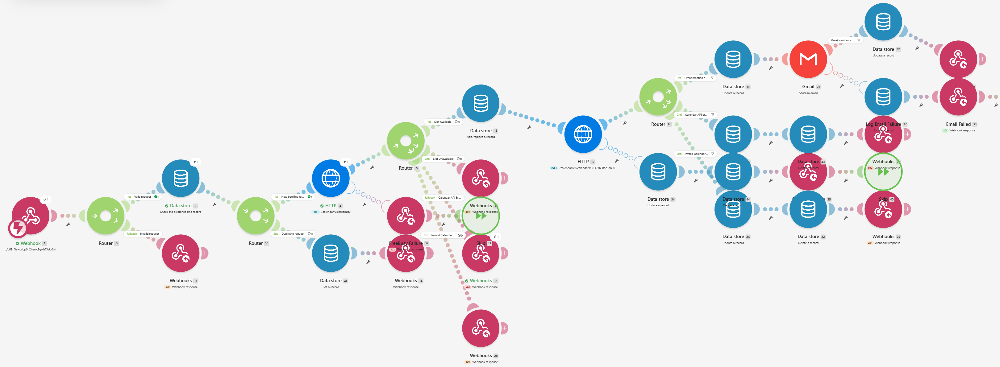

# Smart Appointment Booking API

**An API-driven appointment booking automation built with Make.com, Google Calendar, Gmail, and Make Data Store.**

A workflow designed to automate appointment scheduling, validate booking requests, check real-time calendar availability, prevent duplicate submissions, create calendar events, and deliver email confirmations.

The project demonstrates practical experience with **REST APIs, webhooks, OAuth 2.0, workflow automation, persistent data storage, conditional routing, and error handling**.

> **Project Status:** Prototype developed and configuration validated. Full end-to-end booking verification is pending Google Calendar OAuth reauthorization.

## Workflow Preview



*Make.com scenario showing the booking API, validation, availability checking, calendar integration, persistent storage, and confirmation workflow.*

## Tech Stack

| Technology | Purpose |
|---|---|
| Make.com | Workflow orchestration and automation |
| Webhooks | Receive appointment booking requests |
| HTTP / REST APIs | Communicate with Google Calendar |
| Google Calendar API | Check availability and create appointments |
| OAuth 2.0 | Authenticate Google API requests |
| Make Data Store | Store booking records and identify duplicate requests |
| Gmail | Send appointment confirmation emails |
| Postman | Test API requests and responses |
| JSON | Exchange structured data between services |

## System Architecture

The workflow follows this architecture:

```text
                  CLIENT / POSTMAN
                         |
                         v
                  WEBHOOK API
                         |
                         v
                  INPUT VALIDATION
                         |
               +---------+---------+
               |                   |
            Invalid              Valid
               |                   |
           HTTP 400                v
                            DUPLICATE CHECK
                                  |
                        +---------+---------+
                        |                   |
                     Existing              New
                        |                   |
                   HTTP 200/409             v
                                    GOOGLE CALENDAR
                                     FREEBUSY API
                                           |
                            +--------------+-------------+
                            |              |             |
                          Busy            Free          Error
                            |              |             |
                         HTTP 409          v          HTTP 502
                                    RESERVE BOOKING
                                           |
                                           v
                                     CREATE EVENT
                                           |
                                           v
                                    UPDATE DATA STORE
                                           |
                                           v
                                      SEND GMAIL
                                           |
                                           v
                                    API RESPONSE
                                        HTTP 201
```

## Key Features

### 1. Webhook-Based Booking API

Receives appointment requests through an HTTP POST webhook, enabling integration with websites, forms, chatbots, and external applications.

### 2. Request Validation

The validation logic is configured to check required fields, email and date/time formats, future appointments, and allowed booking hours.

The configured business rules include:

- Business timezone: `Africa/Cairo`
- Working hours: 09:00 to 17:00
- Appointment duration: 60 minutes
- Latest available start time: 16:00

### 3. Real-Time Calendar Availability

Uses Google Calendar's FreeBusy API to determine whether a requested time slot overlaps with an existing calendar event.

The availability router distinguishes between available slots, occupied slots, and API errors.

### 4. Duplicate Request Handling

Uses persistent Make Data Store records and deterministic booking identifiers to identify repeated submissions.

The configured duplicate-handling paths return existing confirmed booking details or a conflict response for non-confirmed records.

### 5. Automated Calendar Event Creation

When a request passes validation and availability checks, the workflow is configured to create a Google Calendar event containing:

- Customer name
- Requested service
- Appointment start and end times
- Customer email
- Booking details

### 6. Email Confirmation

The Gmail integration is configured to send a confirmation after successful calendar event creation.

The workflow also includes error handling intended to preserve confirmed appointments if email delivery fails.

### 7. Structured API Responses

The API defines the following responses:

| HTTP Status | Meaning |
|---|---|
| `201 Created` | Appointment successfully created |
| `200 OK` | Existing confirmed booking retrieved |
| `400 Bad Request` | Invalid booking request |
| `409 Conflict` | Unavailable slot or conflicting booking state |
| `500 Internal Server Error` | Internal workflow failure |
| `502 Bad Gateway` | Google Calendar or upstream integration failure |

## Example API Request

**Method:** `POST`

**Content-Type:** `application/json`

```json
{
  "name": "Yara",
  "email": "yara@example.com",
  "service": "Consultation",
  "date": "2026-11-16",
  "time": "14:00",
  "timezone": "Africa/Cairo"
}
```

The webhook endpoint is intentionally excluded for security.

## Example Success Response

The following represents the intended response after successful calendar event creation:

```json
{
  "success": true,
  "status": "confirmed",
  "message": "Appointment booked successfully",
  "booking_id": "generated_booking_id",
  "calendar_event_id": "google_calendar_event_id"
}
```

### Completed

- Configured the webhook API and tested request intake.
- Successfully tested Google Calendar FreeBusy requests during development.
- Identified and corrected routing logic that misclassified empty busy arrays.
- Configured dynamic appointment timestamps.
- Added request validation, booking storage, and duplicate-handling routes.
- Configured Google Calendar event creation and Gmail notifications.
- Configured booking success and error response paths.
- Validated the scenario blueprint without editor errors or warnings.

## Project Purpose

This project was created to explore the design of an API-based automation system that connects multiple external services.

It focuses on combining webhook communication, structured JSON processing, conditional logic, persistent storage, third-party APIs, OAuth authentication, and error recovery into a single practical workflow.
